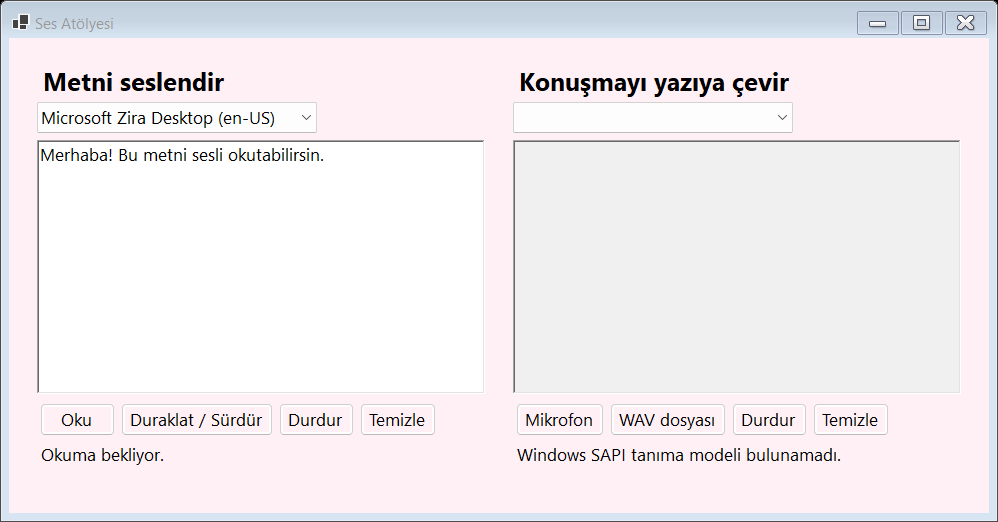
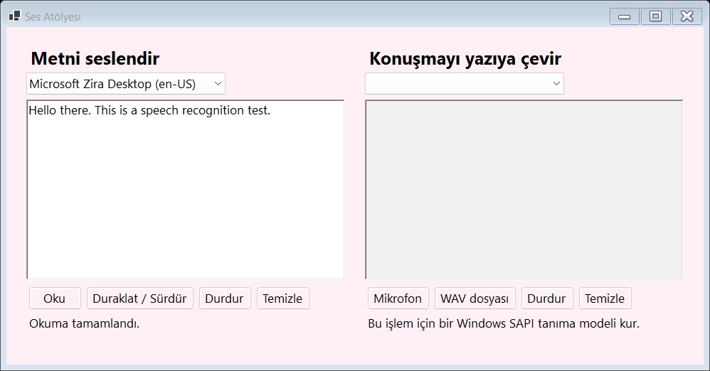

# Ses Atölyesi

Yerel Windows sesleriyle metin okuyan ve desteklenen tanıyıcıyla mikrofonu veya WAV konuşmasını yazıya çeviren uygulama.

## Teknoloji

C# / .NET 10, Windows Forms ve [System.Speech 10.0.0](https://www.nuget.org/packages/System.Speech/10.0.0).

## Kurulum ve çalıştırma

Windows, Git ve .NET 10 SDK gerekir. Visual Studio kullanıyorsan **.NET masaüstü geliştirme** iş yükünü kur. Kendi GitHub kullanıcı adını aşağıdaki komutta yerine yaz.

```powershell
git clone https://github.com/GITHUB_KULLANICI_ADI/YMH219-SpeechApp.git
cd YMH219-SpeechApp
```


```powershell
dotnet restore
dotnet run
```

## Özellikler

- Sol bölümde bir ses seç, metin yaz ve **Oku** düğmesine bas. Okumayı duraklatabilir, sürdürebilir veya durdurabilirsin.
- Sağ bölümde tanıma dilini seç. **Mikrofon** canlı giriş, **WAV dosyası** yerel PCM WAV girişi kullanır. **Durdur** oturumu sonlandırır.
- Windows Ayarları → Saat ve Dil → Dil ve Bölge bölümünden gereken dili ve varsa konuşma özelliklerini yükle. Ses paketlerini Ayarlar → Saat ve Dil → Konuşma bölümünden kontrol et.
- Windows Ayarları → Gizlilik ve güvenlik → Mikrofon bölümünde masaüstü uygulamalarına erişim ver. Uygulamayı yeniden açınca seçiciler Windows SAPI’nin sunduğu ses ve tanıyıcıları listeler.

## Ekran görüntüleri





## Sınırlamalar

Türkçe ve İngilizce desteği cihazda kurulu SAPI sesleri ve tanıyıcılarına bağlıdır. Bir Windows dil paketi her zaman SAPI dikte tanıyıcısı sağlamaz. Föy sabit bir tanıma dili belirtmiyor.

## Yerel test sonuçları

- Metin okuma: İngilizce `en-US` ile Microsoft Zira Desktop okuma işlemini tamamladı. Türkçe ses listelenmedi.
- WAV ile konuşma tanıma: Windows SAPI dikte modeli listelenmediğinden bu cihazda doğrulanamadı.
- Gerçek mikrofonla konuşma tanıma: Model önkoşulunda durdu. Eksik model bildirimi doğrulandı, canlı konuşma çözümlenmedi.

## Öğrenci

Ad soyad ve öğrenci numarası teslimden önce eklenecek.
